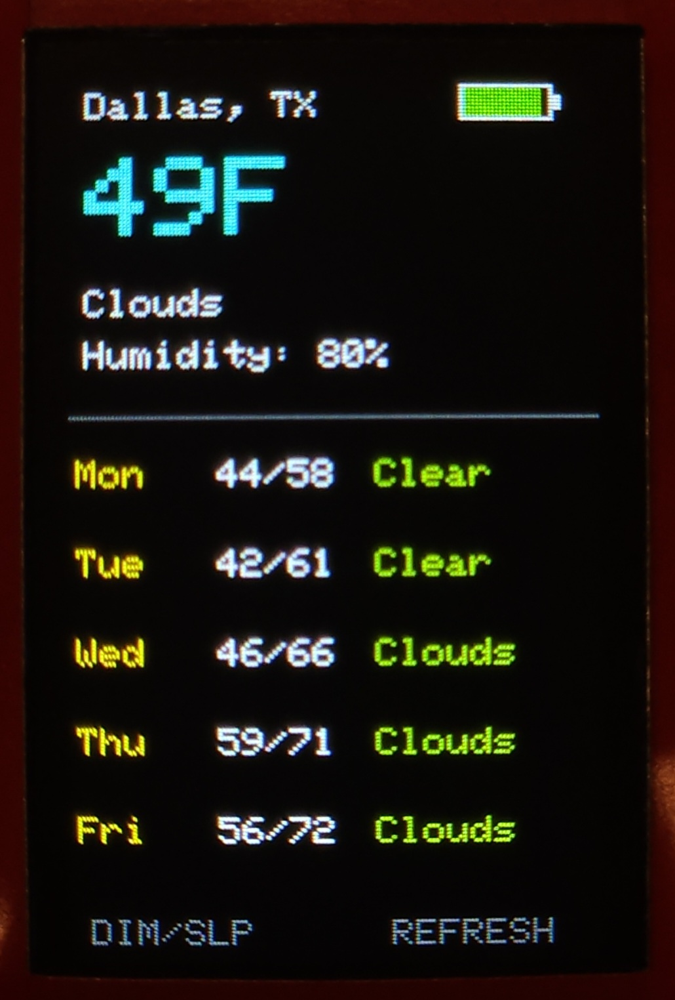

# ESP32 Weather Station

A portable weather station built on an ESP32 and ST7789 display using live weather data from OpenWeatherMap.

Designed for compact ESP32 display boards such as the Tenstar ESP32 Display Board and LilyGO T-Display style hardware, this project provides current conditions, humidity, a multi-day forecast, battery monitoring, adjustable brightness control, and deep sleep support in a small battery-powered package.

---

## Screenshot



*Weather station running on an ESP32 display board showing current conditions and a five-day forecast for Dallas, Texas.*

---

## Features

### Current Conditions

- Current temperature
- Current weather conditions
- Humidity display
- Location display
- Automatic weather updates

### Multi-Day Forecast

- Five-day weather forecast
- Daily low temperatures
- Daily high temperatures
- Weather conditions by day
- Day-of-week display

### Battery Monitoring

- Real-time battery level monitoring
- Graphical battery indicator
- Color-coded battery status
- Designed for portable battery-powered use

### Power Management

- Adjustable display brightness
- Four brightness levels
- Deep sleep mode
- Wake-on-button press
- Reduced power consumption

### Connectivity

- Automatic Wi-Fi connection
- OpenWeatherMap integration
- Manual refresh button
- Automatic refresh interval

---

## Hardware

### Tested Hardware

- ESP32 Dev Module
- Tenstar ESP32 Display Board
- LilyGO T-Display Style Boards
- ST7789 135x240 LCD

### Display Connections

```cpp
#define TFT_CS     5
#define TFT_DC    16
#define TFT_RST   23
#define TFT_MOSI  19
#define TFT_SCLK  18
#define TFT_BL     4
```

### Buttons

```cpp
#define BTN_SCREEN   35
#define BTN_REFRESH   0
```

---

## Controls

### DIM / SLEEP Button

Short Press

```text
100%
50%
25%
10%
```

Long Press (2 Seconds)

```text
Enter Deep Sleep
```

Press the button again to wake the device.

### REFRESH Button

Short Press

```text
Download latest weather data
```

---

## Display Layout

### Current Conditions
